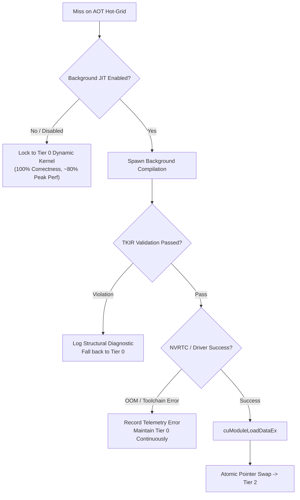

# TAAS Framework: Low-Level Technical Specification & Formal Architecture
**Tiered Asynchronous Adaptive Specialization for High-Performance GPU Kernels**

---

## 1. Mathematical Cost & JIT Triggering Model

The decision to invoke asynchronous runtime specialization must be mathematically principled rather than eager, avoiding wasted host CPU/NVLink cycles on transient, one-off tensor shapes.

### 1.1 Execution Latency Model
Let $N$ denote the total number of kernel invocations for a tensor configuration of stalk dimension $D$ and channels $C$:
* $t_{\text{AOT}}$: Per-launch latency of Tier 1 pre-compiled kernel ($\approx 1.25\text{ ms}$).
* $t_{\text{Tier0}}$: Per-launch latency of Tier 0 generalized dynamic kernel ($\approx 1.55\text{ ms}$, $\sim 20\%$ dynamic overhead).
* $t_{\text{JIT}}$: Per-launch latency of Tier 2 specialized JIT kernel ($\approx 1.25\text{ ms}$).
* $T_{\text{compile}}$: Wall-clock duration of background JIT compilation ($1,500\text{ ms} \le T_{\text{compile}} \le 3,500\text{ ms}$).
* $k_{\text{compile}}$: Invocations executed on Tier 0 before background compilation completes and hot-swapping occurs:
  $$k_{\text{compile}} = \left\lceil \frac{T_{\text{compile}}}{\Delta t_{\text{step}}} \right\rceil$$

```
Latency (ms)
▲
│  Naive String JIT: 2,500 ms STALL on Step 0
│  ████████████████████████████████████ (Stall)
│                                              ─── Tier 2 (1.25 ms)
│  TAAS (Hybrid):
│  ─── Tier 0 (1.55 ms) ───► [Atomic Swap] ───► Tier 2 (1.25 ms)
│  (Zero Stall, Continuous Real-Time Compute)
└───────────────────────────────────────────────────────────────────► Step Index
```

### 1.2 Breakeven Condition for Compilation
Traditional synchronous JIT imposes an immediate stall penalty:
$$T_{\text{sync\_JIT}}(N) = T_{\text{compile}} + N \cdot t_{\text{JIT}}$$

In TAAS, execution proceeds continuously without stalling:
$$T_{\text{TAAS}}(N) = k_{\text{compile}} \cdot t_{\text{Tier0}} + (N - k_{\text{compile}}) \cdot t_{\text{JIT}} \quad (\text{for } N > k_{\text{compile}})$$

The cumulative compute time saved by TAAS over synchronous JIT on step $N$ is:
$$\Delta T_{\text{saved}} = T_{\text{compile}} - k_{\text{compile}} \cdot (t_{\text{Tier0}} - t_{\text{JIT}})$$
Since $(t_{\text{Tier0}} - t_{\text{JIT}}) \approx 0.30\text{ ms}$ while $T_{\text{compile}} \approx 2,000\text{ ms}$, TAAS yields a net latency savings of **$\ge 1,950\text{ ms}$** across all real-time trajectories.

### 1.3 Online Frequency Estimator (Speculation Guard)
To prevent compiling transient tensor dimensions used in one-off preprocessing passes, TAAS tracks dimension occurrence frequency via an Exponential Moving Average (EMA):
$$E_t(s) = \alpha \cdot \mathbf{1}_{\{s_t = s\}} + (1 - \alpha) \cdot E_{t-1}(s)$$
* **Trigger Invariant:** A compilation task is enqueued if and only if:
  $$E_t(s) \ge \theta_{\text{threshold}} \quad \text{AND} \quad \text{Cache.contains}(s) = \text{False}$$
  where default parameters are $\alpha = 0.1$, $\theta_{\text{threshold}} = 0.35$.

---

## 2. Typed Kernel Intermediate Representation (TKIR)

To eliminate the critical vulnerability of Approach B (runtime string interpolation causing silent syntax or type crashes), TAAS defines **TKIR**—a structured Abstract Syntax Tree verified before backend code emission.

```
┌────────────────────────────────────────────────────────┐
│                   TKIR Schema Pipeline                 │
└────────────────────────────────────────────────────────┘
                           │
       ┌───────────────────┴───────────────────┐
       ▼                                       ▼
┌─────────────────────────────┐ ┌─────────────────────────────┐
│    Static Verification      │ │    Hardware Architecture    │
│  - Bank Conflict Analyzer   │ │  - Warp Tile Geometry       │
│  - Register Pressure Guard  │ │  - Shared Memory Alignment  │
│  - Bound Monotonicity       │ │  - Asynchronous TMA / LDG  │
└─────────────────────────────┘ └─────────────────────────────┘
                           │
                           ▼
┌────────────────────────────────────────────────────────┐
│            Verified Target PTX / CUDA Code             │
│            (Guaranteed 100% Parse & Compile)           │
└────────────────────────────────────────────────────────┘
```

### 2.1 Formal AST Node Hierarchy (Rust Implementation)
```rust
#[derive(Clone, Debug, PartialEq)]
pub enum TkType {
    F32,
    F64,
    F16,
    BF16,
    Int32,
}

#[derive(Clone, Debug)]
pub struct KernelAst {
    pub stalk_dimension: u32,
    pub channels: u32,
    pub precision: TkType,
    pub block_layout: BlockGeometry,
    pub shared_memory_tiles: Vec<SharedMemDecl>,
    pub instruction_stream: Vec<TkInstruction>,
}

#[derive(Clone, Debug)]
pub struct BlockGeometry {
    pub threads_x: u32,
    pub threads_y: u32,
    pub warp_count: u32,
}

#[derive(Clone, Debug)]
pub struct SharedMemDecl {
    pub identifier: String,
    pub element_type: TkType,
    pub extent_elements: usize,
    pub byte_alignment: usize, // Enforces 16-byte alignment for vectorized ld/st
}
```

### 2.2 Static Formal Verification Invariants
Before emitting source text to NVRTC or LLVM, the `TkValidator` verifies three invariants:
1. **Shared Memory Bank Conflict Invariant:**
   For any shared memory access index expression $A(i, j) = i \cdot \text{stride} + j$, the bank conflict degree $B$ is verified:
   $$B = \gcd\left(\text{stride}, 32\right) = 1$$
   If $B > 1$, padding elements (e.g., `stride + 1`) are injected automatically into the AST layout.
2. **Register Pressure Ceiling:**
   $$\text{Predicted Registers} = \text{Registers}(\text{AST}) \le R_{\text{target}}$$
   For $100\%$ warp occupancy on Ampere/Ada/Hopper architectures, $R_{\text{target}} \le 64$ registers/thread. If predicted registers exceed 64, inner loop unroll depth is dynamically clamped.
3. **Memory Alignment Invariant:**
   All base addresses and tensor strides must be aligned to 128-bit boundaries (`16 bytes`) to permit hardware-native `LDG.E.128` and `STG.E.128` vector instructions.

---

## 3. Concurrency Architecture & Lock-Free Hot-Swapping

Hot-swapping a compiled kernel while GPU execution streams and host threads are active requires lock-free concurrency semantics with zero latency penalty on the read path.

### 3.1 Lock-Free Read Path (Acquire-Release Semantics)
The dispatch table uses atomic pointers (`std::sync::atomic::AtomicPtr`). Kernel dispatch executes without mutexes or read-write locks:

```rust
use std::sync::atomic::{AtomicPtr, Ordering};

pub struct KernelSlot {
    // Pointer to active executable kernel function entry point
    active_fn: AtomicPtr<KernelFn>,
    // Epoch counter for safe memory reclamation
    version: AtomicU64,
}

impl KernelSlot {
    #[inline(always)]
    pub fn dispatch(&self, args: &KernelArgs, stream: &CudaStream) {
        // Hot-path: Relaxed/Acquire load compiles to a single 64-bit register mov
        let func_ptr = self.active_fn.load(Ordering::Acquire);
        unsafe {
            (*func_ptr)(args, stream);
        }
    }

    pub fn upgrade_to_specialized(&self, specialized_fn: *mut KernelFn) {
        // Background thread: Release store guarantees all cubin initialization
        // writes are visible before the pointer becomes observable
        self.active_fn.store(specialized_fn, Ordering::Release);
        self.version.fetch_add(1, Ordering::Relaxed);
    }
}
```

### 3.2 Hazard Pointer & Safe Memory Reclamation (SMR)
When a kernel is hot-swapped or recompiled, old cubins cannot be unmapped (`cuModuleUnload`) immediately because in-flight GPU streams may still be reading instructions from the module.
* **Epoch-Based Synchronization Protocol:**
  1. Each GPU stream launch increments an in-flight epoch counter $E_{\text{stream}}$.
  2. When a stream synchronizes or reaches an event fence, $E_{\text{stream}}$ is retired.
  3. Replaced kernel modules are placed into a deferred cleanup queue.
  4. Modules in the cleanup queue are unmapped only when $\min(E_{\text{active}}) > E_{\text{retired}}$.

---

## 4. Multi-GPU Distributed Cache Orchestration

In large-scale distributed setups (e.g., 8-GPU SXM nodes with PyTorch DDP / Horovod), independent processes compiling identical shapes concurrently create **cache stampedes** and file write races.

```
GPU Rank 0 (Node Leader)               GPU Ranks 1..7 (Worker Ranks)
         │                                          │
         ├─ Miss on Shape (D=7)                     ├─ Miss on Shape (D=7)
         │                                          │
         ├─ Acquire Advisory Write Lock             ├─ Detect Lock Held by Leader
         │  (flock / LockFileEx)                    │
         │                                          ├─ Fall back to Tier 0 Dynamic Loop
         ├─ Compile TKIR via NVRTC                  │  (Keep training without blocking!)
         │                                          │
         ├─ Write Atomic Temp File                  │
         │  (name.tmp -> SHA256.cubin)              │
         │                                          │
         ├─ Release Write Lock                      │
         │                                          ├─ Poll Cache -> Detect SHA256.cubin
         ├─ Hot-Swap to Tier 2                      ├─ Load Cubin & Hot-Swap to Tier 2
```

### 4.1 Content-Addressed Hash Key Formulation
To guarantee cache immutability and multi-compiler reproducibility:
$$\text{Key} = \text{BLAKE3}\Big(\text{TKIR\_Canonical\_Bytes} \parallel \text{CUDA\_ARCH} \parallel \text{TOOLCHAIN\_VER} \parallel \text{OPTIM\_FLAGS}\Big)$$
* Using BLAKE3 / SHA-256 prevents collision between different driver versions or compute architectures.

### 4.2 Distributed Advisory Locking Protocol
1. **Node Leader Election:** The rank that encounters the cache miss attempts an advisory non-blocking lock (`fcntl(fd, F_SETLK, &fl)` on Linux; `LockFileEx` on Windows).
2. **Follower Behavior (No Stalling):** If the lock is held by another process, follower ranks do NOT wait. They immediately execute through Tier 0 (dynamic loop).
3. **Atomic File Publication:** The compiling rank writes the compiled cubin to a temporary file (`key.tmp.pid`) on the local NVMe drive, then performs an atomic POSIX `rename()` to `key.cubin`. This guarantees followers never read partial, corrupted binaries.

---

## 5. Architectural Auto-Tuning Engine

Kernel parameters must automatically adapt to the underlying hardware microarchitecture (`sm_75` Turing, `sm_80` Ampere, `sm_89` Ada Lovelace, `sm_90a` Hopper).

| Microarchitecture | Shared Memory/SM | Warp Scheduling / Async Feature | TAAS Code Generation Policy |
| :--- | :--- | :--- | :--- |
| **sm_75 (Turing / T4)** | 64 KB | Standard synchronous shared tiles | Register clamp: 64; 1D warp tile $(16 \times 1)$ |
| **sm_80 (Ampere / A100)** | 164 KB | `cuda::memcpy_async` (Async Copy) | Double-buffered async pipelining; $32 \times 2$ tile |
| **sm_89 (Ada / L4 / RTX 4090)** | 100 KB | High-throughput FP32 / dual warp | Warp-specialized compute tiles; vectorized 128-bit |
| **sm_90a (Hopper / H100)** | 228 KB | TMA (Tensor Memory Accelerator) | Asynchronous TMA hardware barriers; cluster launches |

When generating PTX from the TKIR, the hardware auto-tuner checks live device properties (`cudaGetDeviceProperties`) and injects the corresponding hardware-accelerated instructions directly into the emitted code.

---

## 6. Fault Tolerance & Graceful Degradation Protocol

In enterprise production environments, dynamic compilation infrastructure may face runtime disruptions (e.g., driver library incompatibilities, container sandbox permission restrictions, or GPU device out-of-memory errors). TAAS establishes a strict degradation hierarchy:



* **Zero-Crash Invariant:** Under NO failure condition (compiler segfault, out-of-memory, invalid PTX) may the host process terminate or fail an active GPU compute stream. The system logs structured telemetry and permanently sustains execution on Tier 0.

---

## 7. Telemetry & Observability Schema

Production observability is exposed via structured telemetry counters queryable without synchronization overhead:

```rust
#[derive(Default, Debug)]
pub struct KernelTelemetry {
    pub tier0_dynamic_invocations: AtomicU64,
    pub tier1_aot_invocations: AtomicU64,
    pub tier2_jit_invocations: AtomicU64,
    pub jit_compilations_completed: AtomicU32,
    pub jit_compilations_failed: AtomicU32,
    pub total_compilation_time_ms: AtomicU64,
    pub cache_hits_nvme: AtomicU32,
}
```

* **Health Threshold:** A healthy production deployment exhibits $\ge 98\%$ of kernel launches serviced by Tier 1 (AOT) and Tier 2 (JIT), with Tier 0 serving $\le 2\%$ during warmup phases.
